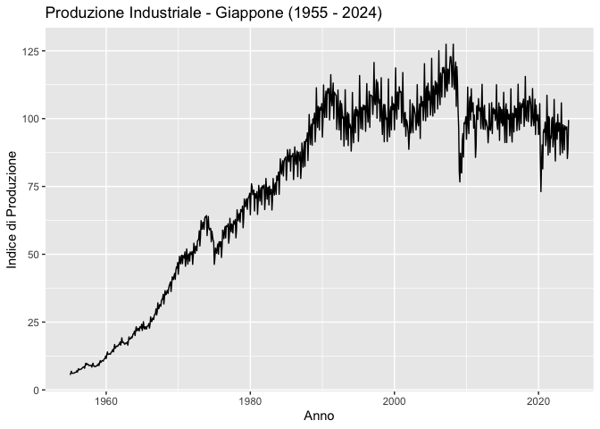
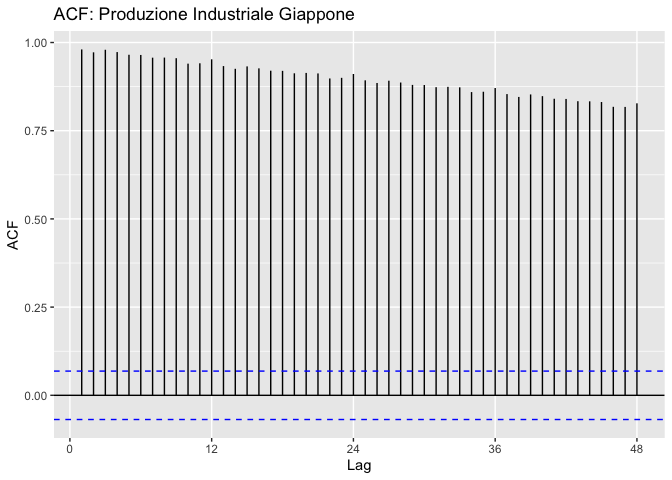
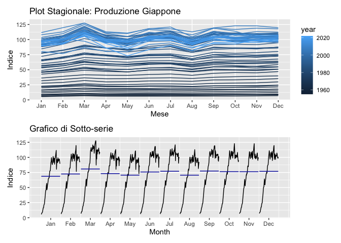
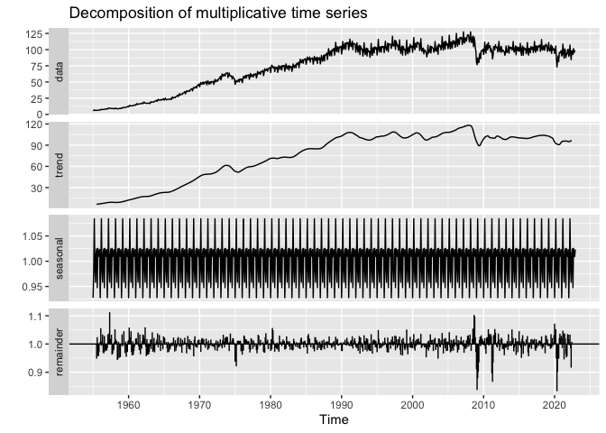
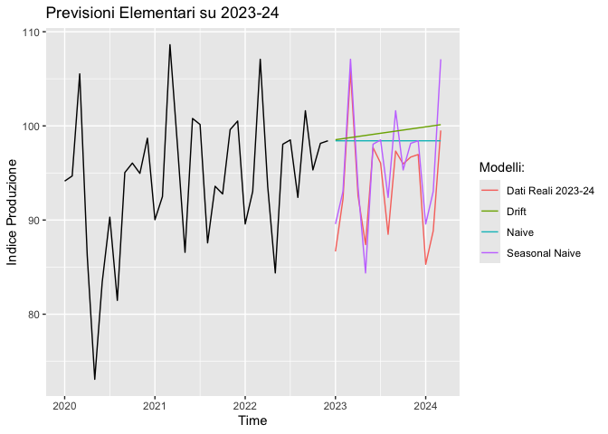
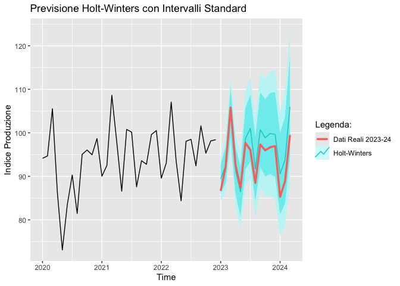
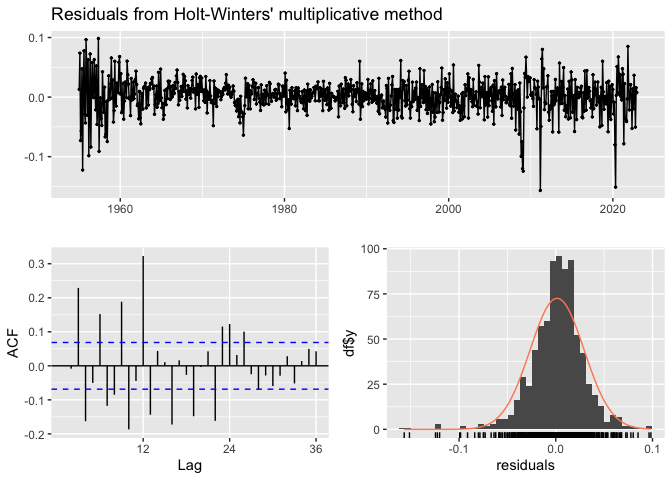
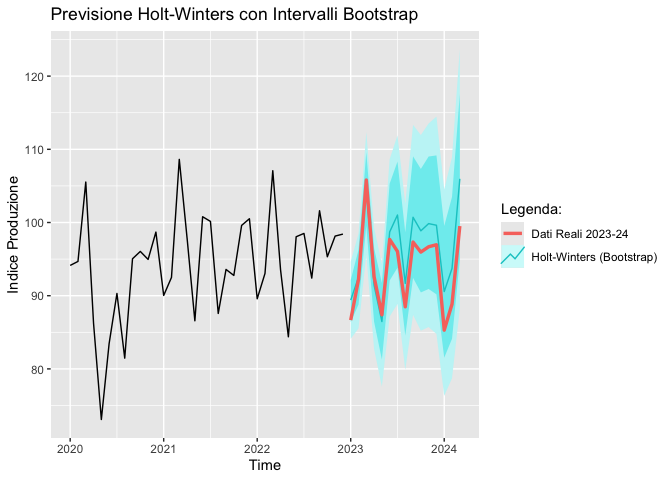
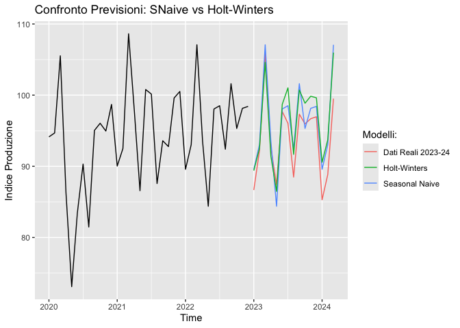

Serie Storiche: Produzione Industriale del Giappone
================
Dario Falaschi
2026-03-16

``` r
knitr::opts_chunk$set(warning = FALSE, message = FALSE, echo=FALSE)
```

# 1. Importazione e Creazione della Serie Storica —

Questo script contiene l’analisi della serie storica relativa all’Indice
della Produzione Industriale del Giappone. I dati mensili grezzi sono
stati estratti dal database FRED ([Serie:
JPNPRINTO01IXOBM](https://fred.stlouisfed.org/series/JPNPRINTO01IXOBM)).
Al fine di garantire la perfetta integrità dei cicli stagionali, la
serie storica analizzata viene troncata a Dicembre 2022, garantendo 68
anni di osservazioni complete. Il 2023 e i primi mesi del 2024 verranno
conservati come Test Set per la validazione dei modelli.

<!-- -->

L’analisi visiva preliminare mostra un evidente e persistente trend di
crescita fino all’inizio degli anni ’90, seguito dai periodi di
stagnazione economica e dalle forti crisi del 2008 e 2020. Si nota
inoltre un pattern stagionale la cui varianza aumenta proporzionalmente
alla crescita del trend.

# 2 Analisi dell’Autocorrelazione (ACF) e Grafici Stagionali

Per confermare formalmente la non-stazionarietà della serie e la forte
stagionalità intravista nel grafico principale, calcoliamo la Funzione
di Autocorrelazione.

<!-- -->

Il correlogramma mostra un decadimento estremamente lento, sintomo
inequivocabile di un trend persistente, accompagnato da “onde”
periodiche che riflettono la stagionalità del dato. Per evidenziare
meglio questi pattern annuali ricorrenti, analizziamo il grafico
stagionale e il grafico delle sotto-serie.

<!-- -->

# 3. Decomposizione

Considerando l’ampio orizzonte temporale (1955-2022) e l’evidente
aumento della varianza in concomitanza con la crescita del trend, la
scomposizione additiva risulterebbe inadeguata. Si procede pertanto con
una decomposizione moltiplicativa per isolare le tre componenti: Trend,
Stagionalità e Rumore.

<!-- -->

# 4. Modelli di Predizione di Base

Prima di passare a modelli più complessi, è fondamentale testare
algoritmi elementari per definire una base di performance. Vengono
stimati tre modelli di base sull’orizzonte temporale del Test Set.

<!-- -->

# 5. Modello Esponenziale Holt-Winters

Dato che la serie storica presenta sia un trend evidente sia una forte
stagionalità moltiplicativa, il modello matematico di lisciamento
esponenziale di Holt-Winters rappresenta una soluzione ideale. Si
addestra il modello specificando la natura moltiplicativa della
stagionalità.

Il grafico sottostante mostra la previsione puntuale del modello
affiancata dai rispettivi intervalli di previsione standard (all’80% e
al 95%).

<!-- -->

Per convalidare la correttezza strutturale del modello e l’affidabilità
degli intervalli di previsione appena mostrati, si procede all’analisi
formale dei residui.

<!-- -->

    ## 
    ##  Ljung-Box test
    ## 
    ## data:  Residuals from Holt-Winters' multiplicative method
    ## Q* = 360.04, df = 24, p-value < 2.2e-16
    ## 
    ## Model df: 0.   Total lags used: 24

    ## 
    ##  Shapiro-Wilk normality test
    ## 
    ## data:  residuals(mod_hw)
    ## W = 0.94783, p-value = 2.241e-16

I test hanno respinto l’ipotesi di gaussianità dei residui, evidenziando
la presenza di outlier legati agli shock economici. L’assunzione di
normalità alla base degli intervalli (mostrati nel primo grafico)
rischia quindi di sottostimare la reale incertezza futura. Per
correggere questo problema, si ricalcolano gli intervalli di previsione
utilizzando il metodo Bootstrap.

<!-- -->

# 6. Previsioni Finali e Validazione

Per decretare il modello migliore, confrontiamo prima visivamente le due
previsioni più rilevanti (Seasonal Naive e Holt-Winters) con i dati veri
del Test Set (Gennaio 2023 - Marzo 2024). Successivamente, valutiamo sul
Test Set l’errore quadratico medio (RMSE), l’errore assoluto medio (MAE)
e l’errore percentuale assoluto medio (MAPE) di tutti i modelli stimati.

<!-- -->

    ##                RMSE  MAE MAPE
    ## Naive          7.16 5.72 6.32
    ## Seasonal Naive 3.25 2.64 2.84
    ## Drift          7.78 6.44 7.11
    ## Holt-Winters   3.44 2.95 3.16
