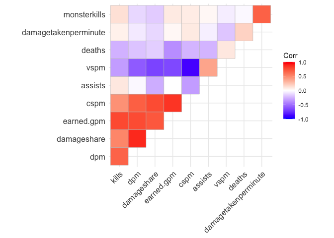
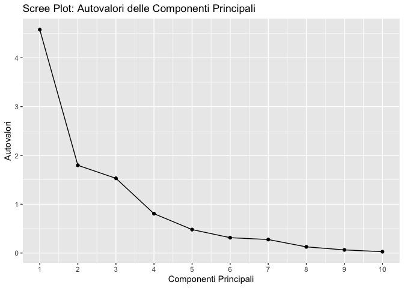
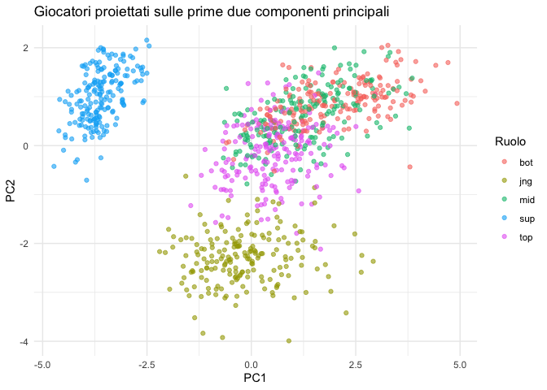
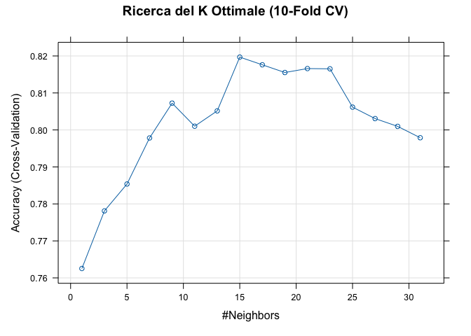
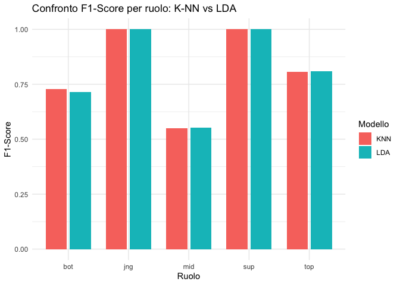

Classificazione dei Ruoli in League of Legends
================
Dario Falaschi
2026-03-06

``` r
knitr::opts_chunk$set(warning = FALSE, message = FALSE, echo=FALSE)
```

# 1. Introduzione e Obiettivo dell’Analisi

Il presente report ha l’obiettivo di sviluppare un modello di
classificazione multiclasse in grado di prevedere il ruolo (Top, Jungle,
Mid, ADC, Support) dei giocatori professionisti di *League of Legends*.
I dati grezzi sono stati estratti dal portale [Oracle’s
Elixir](https://oracleselixir.com/tools/downloads) e si riferiscono alle
partite del Campionato Mondiale (Worlds) 2025.

# 2. Data Cleaning

In questa fase, il dataset originale è stato filtrato per isolare le
sole osservazioni relative ai singoli giocatori durante il torneo di
interesse.

Il file grezzo di Oracle’s Elixir non è incluso nel repository per le
sue dimensioni: se non è presente nella cartella, viene caricato
`dati_puliti.csv`, che contiene lo stesso dataset già filtrato e con le
sole variabili selezionate.

Il dataset risultante presenta un’altissima dimensionalità (165
variabili). Sono state selezionate le features più rilevanti. Nello
specifico, sono state scartate:

- metadati e variabili identificative (gameid, playername, champion,
  ecc.), prive di utilità
- statistiche di macro-gioco (es. uccisione di draghi o torri)
- rilevazioni a minutaggio fisso (es. gold at 10/15 mins) e possibili
  valori mancanti (NA) nelle partite di breve durata.

<!-- -->

    ## [1] 0

# 3. Analisi Esplorativa

Prima di procedere alla classificazione, indaghiamo le relazioni tra le
variabili selezionate. Questo passaggio è utile per identificare
eventuali ridondanze (multicollinearità) o pattern evidenti nelle
statistiche di gioco.

<!-- -->

Si osserva una forte correlazione positiva tra `kills`, `dpm`,
`damageshare`, `earned.gpm` e `cspm`. Spicca una forte correlazione
inversa tra `vspm` (visione) e `cspm` (farm). E infine una correlazione
positiva tra `monsterkills` e `damagetakenperminute`.

Per valutare la separabilità globale delle classi tenendo conto di tutte
le variabili contemporaneamente, applichiamo la PCA. Essendo le
variabili espresse in unità di misura diverse (es. danni vs uccisioni),
i dati sono stati preventivamente standardizzati.
<!-- -->

Come si evince dallo Scree Plot, l’applicazione congiunta del criterio
di Kaiser e del metodo del gomito suggerisce di trattenere le prime tre
componenti principali (PC1, PC2, PC3).

Proiettando i giocatori sulle prime due componenti principali è
possibile valutare visivamente quanto i ruoli risultino separati.
<!-- -->

# 4. Modello di Classificazione k-NN

Di seguito viene addestrato e valutato il classificatore K-NN. Il
modello è ottimizzato tramite una 10-Fold Cross-Validation sull’intero
dataset, all’interno della quale le variabili numeriche vengono
automaticamente standardizzate. Per prevenire situazioni di parità
nell’assegnazione delle classi, la ricerca del parametro ottimale viene
effettuata su una griglia di valori k dispari compresi tra 1 e 31. Al
termine dell’addestramento, il codice genera il grafico relativo
all’andamento del parametro, la Matrice di Confusione e un dataframe
riassuntivo contenente le metriche di Sensibilità, Precisione ed
F1-Score per ogni singolo ruolo. Tutte le metriche sono calcolate sulle
previsioni *out-of-fold* della cross-validation: ogni giocatore viene
classificato da un modello che non lo ha visto in addestramento.
<!-- -->

    ## Cross-Validated (10 fold) Confusion Matrix 
    ## 
    ## (entries are percentual average cell counts across resamples)
    ##  
    ##           Reference
    ## Prediction  bot  jng  mid  sup  top
    ##        bot 15.8  0.0  6.8  0.0  0.8
    ##        jng  0.0 20.0  0.0  0.0  0.0
    ##        mid  3.6  0.0 10.2  0.0  3.2
    ##        sup  0.0  0.0  0.0 20.0  0.0
    ##        top  0.5  0.0  3.0  0.0 15.9
    ##                             
    ##  Accuracy (average) : 0.8198

    ##            Sensibilità Precisione F1_Score
    ## Class: bot       0.792      0.676    0.729
    ## Class: jng       1.000      1.000    1.000
    ## Class: mid       0.510      0.598    0.551
    ## Class: sup       1.000      1.000    1.000
    ## Class: top       0.797      0.818    0.807

# 5. Modello di Classificazione LDA

In questa sezione viene addestrato e valutato un classificatore
parametrico basato sull’LDA. Al fine di garantire una comparazione
coerente con il modello precedente, le performance sono stimate tramite
una 10-Fold Cross-Validation sull’intero dataset, applicando la
standardizzazione automatica delle variabili numeriche. Il codice
restituisce l’accuratezza globale del modello, la Matrice di Confusione
e un dataframe riassuntivo con le metriche di Sensibilità, Precisione ed
F1-Score per ogni singolo ruolo.

    ## Cross-Validated (10 fold) Confusion Matrix 
    ## 
    ## (entries are percentual average cell counts across resamples)
    ##  
    ##           Reference
    ## Prediction  bot  jng  mid  sup  top
    ##        bot 14.3  0.0  5.4  0.0  0.2
    ##        jng  0.0 20.0  0.0  0.0  0.0
    ##        mid  5.6  0.0 11.2  0.0  3.9
    ##        sup  0.0  0.0  0.0 20.0  0.0
    ##        top  0.1  0.0  3.3  0.0 15.9
    ##                             
    ##  Accuracy (average) : 0.8146

    ##            Sensibilità Precisione F1_Score
    ## Class: bot       0.714      0.717    0.715
    ## Class: jng       1.000      1.000    1.000
    ## Class: mid       0.562      0.543    0.552
    ## Class: sup       1.000      1.000    1.000
    ## Class: top       0.797      0.823    0.810

# 6. Conclusioni e Confronto delle Performance

In questa sezione finale viene effettuato un confronto visivo tra le
performance dei modelli K-NN e LDA. I valori dell’F1-Score calcolati per
ciascun ruolo vengono aggregati in un unico dataframe. Infine, viene
generato un grafico a barre raggruppate per confrontare a colpo d’occhio
l’efficacia dei due algoritmi sulle singole classi.

<!-- -->
